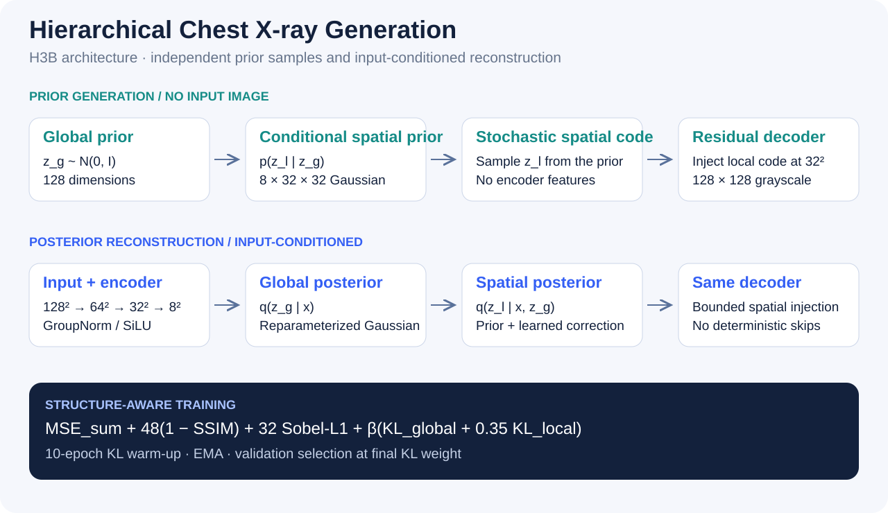
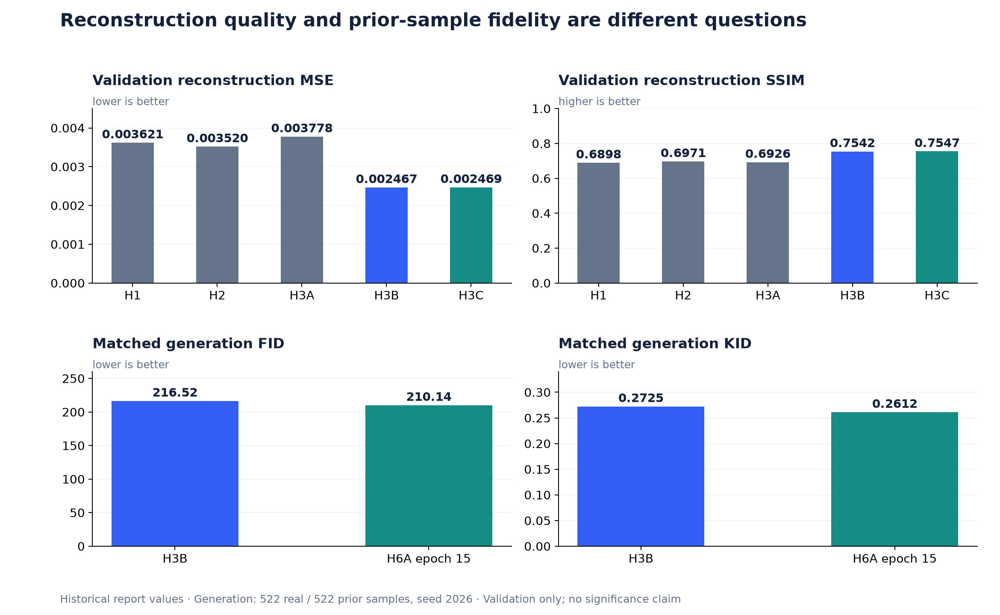
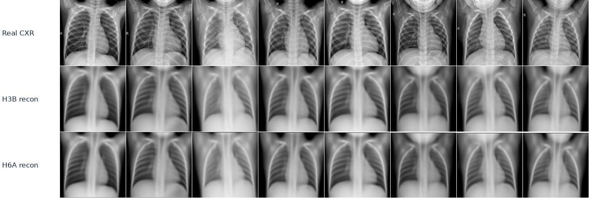
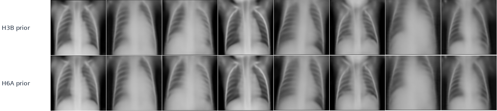
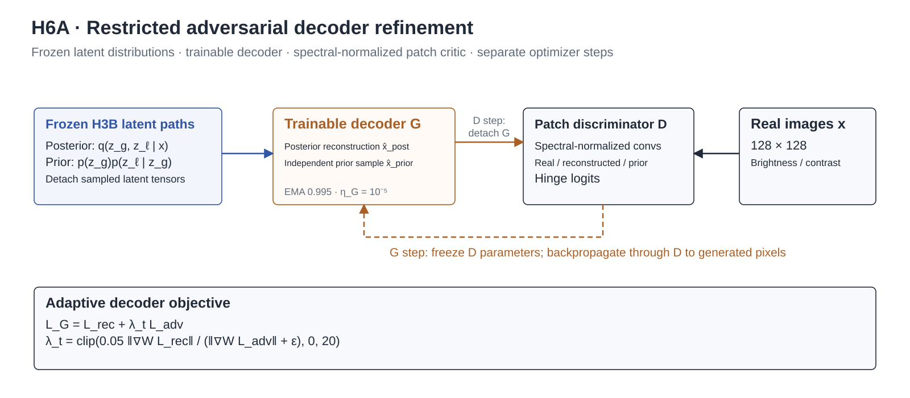

# Hierarchical Chest X-ray Generation

**A two-level variational generative model with structure-aware reconstruction, conditional spatial priors, and decoder-only adversarial refinement.**

From-scratch PyTorch research implementation by **Xinying (Ashley) Liu**, developed for **ECE 285 at UC San Diego**. The project investigates a central tension in generative modeling: improving an input-conditioned reconstruction does not necessarily improve images drawn independently from the prior.

[Technical report (PDF)](docs/report/ECE_285_HW1.pdf) · [Architecture and objectives](docs/architecture.md) · [Experimental protocol](docs/experiments.md) · [Reproduction guide](docs/reproduce.md) · [Portfolio case study](https://ashley-tech628.github.io/projects/hierarchical-cxr-generation/)



## What this project implements

- **Hierarchical stochastic representation:** a 128-dimensional global latent and an `8 × 32 × 32` spatial latent, with a learned conditional Gaussian prior and residual posterior parameterization.
- **Structure-aware optimization:** summed pixel MSE, SSIM, Sobel-edge alignment, ten-epoch KL warm-up, and a reduced spatial KL multiplier.
- **Restricted adversarial adaptation:** freeze the encoder, global mapping, and conditional prior; update only the decoder using a spectral-normalized patch discriminator, hinge loss, and gradient-balanced adversarial weighting.
- **Inspectable experiments:** explicit split manifests, atomic checkpoints, optimizer/RNG resume state, EMA weights, source-checkpoint hashing, and paired-latent generation comparisons.
- **Separate evaluation questions:** MSE/SSIM measure reconstruction; FID/KID/Inception Score measure prior-generated samples under a documented, matched validation protocol.

## Results at a glance

These are **historical results preserved in the current user-supplied report**. Packaging this repository does not rerun the 50-epoch training or regenerate the reported metrics. The provided test directory was not evaluated in the report.

### Validation reconstruction

| Experiment | Representation / objective | Pixel MSE ↓ | SSIM ↑ |
|---|---|---:|---:|
| H1 | Hierarchical, `16 × 16` local grid; MSE + KL | 0.003621 | 0.6898 |
| H2 | `16 × 16` local grid; MSE + SSIM + Sobel + KL | 0.003520 | 0.6971 |
| H3A | `32 × 32` local grid; default local KL weight | 0.003778 | 0.6926 |
| **H3B** | **`32 × 32`; hybrid loss; local KL × 0.35** | **0.002467** | **0.7542** |
| H3C | H3B + multi-scale high-pass reconstruction penalty | 0.002469 | **0.7547** |

Table 1 of the current report records **31.9% lower reconstruction MSE for H3B relative to H1**. H3C has the highest listed SSIM but slightly higher MSE than H3B. H3A demonstrates that enlarging the spatial grid alone does not improve the reported reconstruction result; architecture and regularization must be considered together. The H1→H3B progression changes multiple settings and is not a single-variable ablation.

### Matched validation generation

| Model | FID ↓ | KID mean ↓ | Inception Score ↑ |
|---|---:|---:|---:|
| H3B hierarchical VAE | 216.52 | 0.2725 | 2.287 |
| **H6A decoder refinement, epoch 15** | **210.14** | **0.2612** | **2.321** |

**Protocol:** 522 real validation images and 522 independent prior samples; seed 2026. H6A's evaluator scores both models in one routine, resets separate global/local latent RNG streams for each model, and matches KID subset sampling. H6A lowers recorded FID by **6.38 points (approximately 2.9%)**. No repeated-seed uncertainty or statistical significance is established by these summary values.



### Posterior reconstruction and independent generation



**Input-conditioned reconstruction:** columns align the same real input with its H3B/H6A reconstruction. These images evaluate the posterior path.



**Independent generation:** the two rows use paired latent draws across H3B/H6A. They are not image-to-image pairs with the real inputs above. Coarse anatomy is recognizable, while ribs and pulmonary texture remain oversmoothed.

## Model design

For grayscale input `x ∈ R^(1×128×128)`, the hierarchical model uses:

$$
p_\theta(x,z_g,z_\ell)=p(z_g)p_\theta(z_\ell\mid z_g)p_\theta(x\mid z_g,z_\ell)
$$

$$
q_\phi(z_g,z_\ell\mid x)=q_\phi(z_g\mid x)q_\phi(z_\ell\mid x,z_g).
$$

The encoder downsamples `128 → 64 → 32 → 16 → 8`. Its pooled deepest features parameterize the global posterior. A learned map projects `z_g` to `192 × 8 × 8`, then produces the conditional spatial prior at `32 × 32`.

The spatial posterior predicts corrections to prior parameters:

$$
\mu_q=\mu_p+\Delta\mu,\qquad
\log\sigma_q^2=\mathrm{clip}(\log\sigma_p^2+\Delta\log\sigma^2).
$$

The decoder injects the spatial latent at `32 × 32` using a learned projection and bounded gain, before the final two upsampling stages. Residual blocks use GroupNorm and SiLU. **There are no deterministic encoder-to-decoder skip connections:** generating a new image requires only `z_g ~ N(0,I)` and `z_l ~ p(z_l | z_g)`, without an input radiograph or class label.

### Training objective

$$
\mathcal L = \mathrm{MSE}_{sum}
+48(1-\mathrm{SSIM})
+32\mathcal L_{Sobel}
+\beta_t(\mathrm{KL}_g+0.35\mathrm{KL}_\ell).
$$

`MSE_sum` is summed over pixels and divided by batch size; the reported reconstruction MSE is a separate per-pixel metric. Mixing those normalizations would change the effective regularization strength. KL reaches 1.0 over ten epochs. AdamW starts at `1.5e-4`, with weight decay `1e-4`, batch size 16, gradient clipping at 1.0, and EMA decay 0.999. Checkpoint selection evaluates the objective at the final KL weight, even during warm-up.

This is a **hybrid reconstruction-regularized VAE objective**, not an exact negative ELBO with a fully specified image likelihood. The coefficient 0.35 also changes the relative weighting of the two KL terms.

### Decoder-only adversarial refinement

H6A restores H3B and freezes all encoder and prior parameters. A small patch discriminator with spectral-normalized convolutions receives real images, posterior reconstructions, and independent prior samples. Discriminator and decoder updates use separate optimizers and gradient boundaries.

The decoder receives reconstruction loss plus a weak adversarial term. Its coefficient is calculated from reconstruction/adversarial gradient norms at the last decoder convolution, targeting a ratio of 0.05 and capped at 20. The adaptation uses decoder/discriminator learning rates `1e-5 / 5e-5`, batch size 8, and a 15-epoch schedule. This stage is explicitly a **VAE + adversarial refinement experiment**. A reconstruction-only discriminator option, H6R, is implemented without claiming an unprovided quantitative result.



## Data and evaluation discipline

The [Chest X-Ray Images (Pneumonia) dataset](https://www.kaggle.com/datasets/paultimothymooney/chest-xray-pneumonia) is loaded through `ImageFolder`. The original training directory's **5,216 images** are split by class into **4,694 training / 522 validation images**, using seed 2026. Images become `128 × 128` grayscale tensors. Labels stratify the split; they do not condition the generator.

- The supplied test directory remains outside the reported experiments.
- The split is image-level and class-stratified; patient-disjoint validation was not established.
- Resizing directly to a square changes aspect ratio; there is no lung ROI segmentation or pathology-conditioned sampling.
- Generation metrics convert grayscale samples into three-channel uint8 images for ImageNet Inception features. They are not clinical validity or diagnostic measurements.
- Standalone H3B evaluation and the paired H6A evaluator use different RNG pathways. Use the **paired H6A evaluator** for H3B/H6A comparisons; do not splice unrelated runs into an ablation.

## Run the project

Use a Python environment with a compatible PyTorch/torchvision pair. The original experiments target Kaggle GPU execution; the CPU checks below need no dataset or trained weights.

```bash
python -m venv .venv
# Activate .venv using your shell, then install a compatible PyTorch build.
python -m pip install -r requirements.txt
python -m unittest discover -s tests -v
python code/cxr_h6_adversarial.py unit-test
```

Attach the original dataset and run H3B with explicit paths:

```bash
python code/cxr_h3_research.py check --experiment H3B --data-root /kaggle/input --out-root /kaggle/working/cxr_hvae
python code/cxr_h3_research.py train --experiment H3B --epochs 50 --data-root /kaggle/input --out-root /kaggle/working/cxr_hvae
python code/cxr_h3_research.py inspect --experiment H3B
python code/cxr_h3_research.py export --experiment H3B --include-last
```

To reproduce H6A, first restore the **original H3B checkpoint** and its configuration. Then:

```bash
python code/cxr_h6_adversarial.py check
python code/cxr_h6_adversarial.py train --experiment H6A --fake-mode both --epochs 15 --stop-after 15 --batch-size 8
python code/cxr_h6_adversarial.py evaluate --experiment H6A --checkpoint 15 --split val --n-samples 522 --seed 2026
```

Full path, checkpoint, and protocol details are in [the reproduction guide](docs/reproduce.md). The H6A generation-metric command requires CUDA in the original implementation and may download Inception weights.

## Repository map

```text
code/                       Original experiment implementations
  cxr_hvae.py               H1/H2 baseline
  cxr_h3_research.py         F0, H1, H2, H3A/B/C; training and diagnostics
  cxr_h4b_flow.py            H3B restore helpers; exploratory conditional-flow code
  cxr_h6_adversarial.py      H6A/H6R restricted decoder adaptation; paired evaluation
docs/
  architecture.md           Tensor paths, objective, freezing and optimization
  experiments.md            Protocol, metrics, evidence provenance and limitations
  reproduce.md              Commands, checkpoint layout and verification boundaries
  report/                   Current report plus preserved earlier submission sources
  figures/                  Architecture and figures regenerated from recorded values
results/                    Recorded metric summary and 36 observed history rows
tests/                      Dataset-free implementation checks
tools/build_figures.py      Regenerate figures from the preserved data
```

## Evidence available in this release

The current report (two main-text pages plus one reference page), its extracted figures, four experiment scripts, and **36 observed history rows from a 50-epoch H3B run** are included. The earlier two-page submission PDF and its LaTeX source remain in `docs/report/` as historical artifacts; the supplied current PDF has no accompanying LaTeX source. Missing history epochs are not interpolated in the new plots. Original trained weights and complete raw notebook/ZIP logs are not in the supplied source package and are not included here. Quantitative results are therefore report-backed historical measurements, not independently remeasured release benchmarks.

[Implementation validation](results/implementation-validation.json) records the dataset-free checks performed for this release. Random-weight synthetic checks establish code behavior only; they do not validate the historical image-quality results.

## Research takeaways

1. A larger, less-regularized local latent can preserve spatial detail, while making posterior/prior alignment an important modeling constraint.
2. Structural reconstruction improvements and prior-sample fidelity must be evaluated separately.
3. Restricting adaptation to the decoder makes the comparison interpretable: the latent distributions remain tied to the source H3B checkpoint.
4. The modest reported generation gain leaves high-frequency realism unresolved. Repeated seeds, larger matched evaluations, patient-level splits, and radiograph-specific feature metrics would make stronger follow-up experiments.

This repository is a **course research project**, not a published NeurIPS paper, a diagnostic system, or a clinically validated synthesis tool.

## References and attribution

- Kingma & Welling, [Auto-Encoding Variational Bayes](https://arxiv.org/abs/1312.6114).
- Heusel et al., [GANs Trained by a Two Time-Scale Update Rule Converge to a Local Nash Equilibrium](https://arxiv.org/abs/1706.08500).
- Salimans et al., [Improved Techniques for Training GANs](https://arxiv.org/abs/1606.03498).
- [Dataset source](https://www.kaggle.com/datasets/paultimothymooney/chest-xray-pneumonia); real reference images in the report figure come from that dataset. Dataset images and third-party style files retain their original terms and attribution. See [attribution](docs/attribution.md).
